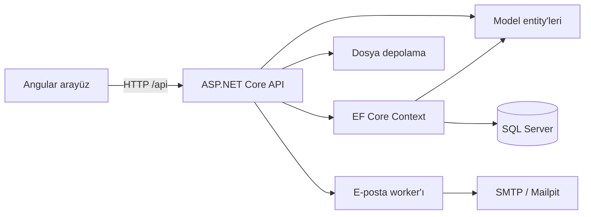

# MeetingApp

ASP.NET Core 10 API, Angular 20.3 arayüz ve SQL Server 2022 kullanan toplantı yönetimi uygulaması.
Kullanıcılar hesap oluşturabilir, kendi toplantılarını ve dokümanlarını yönetebilir, toplantı değişikliklerini
e-posta ile takip edebilir. Model, Context, API ve Web katmanları ayrı projelerdedir.

## Canlı demo

[Uygulamayı aç](https://meetingapp-nida.runasp.net/login)

API ve Angular, MonsterASP.NET Free üzerinde aynı HTTPS adresinden çalışır; veritabanı hosting'deki MSSQL'dir.
HTTPS sertifikası, HTTP → HTTPS yönlendirmesi, SQL bağlantı sağlık kontrolü, korunan API'lerin girişsiz
erişimi reddetmesi ve Angular alt sayfaları doğrulandı. Kullanıcı demo üzerinde yeni hesapla giriş yaptı;
belgeli toplantı oluşturma, belge indirme, mevcut belgeyi koruyarak toplantı düzenleme ve iptal
işlemlerini denedi.

- Canlı demoda Gmail SMTP gönderimi doğrulandı; `EmailDelivery__Enabled=true` ile gönderim worker'ı açık.
  02.11.2026 tarihinde bekleyen 8 mesajın tamamında outbox gönderim tarihi doldu ve hata alanı temizlendi.
  Ardından yeni hesapla kayıt ve toplantı oluşturma denemesinde hoş geldiniz ve toplantı e-postalarının
  alıcının gelen kutusuna ulaştığı kullanıcı tarafından doğrulandı. Yerel Docker kurulumunda e-postalar
  Mailpit'te incelenebilir.
- Free planda üç saat istek almayan uygulama uyuyabilir; bu sırada e-posta ve temizlik worker'ları durur.
  Sonraki ziyaret uygulamayı yeniden başlatır. Kesintisiz arka plan çalışması garanti edilmez.
- Canlı ortamda doğrudan toplantı silme, worker ile silme/trigger ve yeniden başlatma sonrası dosya
  kalıcılığı henüz ayrıca doğrulanmadı. Bu demo için tam otomatik uçtan uca test yapıldığı iddia edilmez.

Yayın adımları ve doğrulama kapsamı [demo yayın rehberinde](docs/DEPLOYMENT.md) yer alır.

## Özellikler

- Ad, soyad, e-posta, telefon, parola ve isteğe bağlı profil resmiyle kayıt.
- E-posta adresinin tekrarını kontrol etme; parolaları ASP.NET Core `PasswordHasher<AppUser>` ile hash'leyerek saklama.
- JWT ile giriş; toplantı ve doküman işlemlerinde API üzerinden kullanıcı sahipliği kontrolü.
- Toplantı listeleme, oluşturma, düzenleme, iptal ve silme; PDF/DOCX yükleme, indirme ve kaldırma.
- Hoş geldiniz ve toplantı oluşturma/güncelleme/iptal e-postaları; SQL outbox üzerinden arka planda gönderim.
- İptal edilen toplantıları bekleme süresi sonunda tablodan tamamen silme ve SQL trigger ile silme günlüğü tutma.
- UTC tarih saklama; ekranda tarayıcının, e-postada alıcının kayıtlı saat dilimine göre gösterim.
- Hesap bilgilerini görüntüleme ve e-posta saat dilimini değiştirme.

Toplantı e-postaları şu anda yalnızca toplantıyı oluşturan kullanıcıya gönderilir.
Hazır kullanıcı hesabı yoktur; ilk kullanımda **Kayıt ol** ekranından hesap oluşturulur.
Arayüzün dosya düzeni ayrıca [Angular rehberinde](MeetingApp.Web/README.md) açıklanır.

## Teknolojiler

| Alan | Teknoloji |
|---|---|
| API | ASP.NET Core 10, C#, controller tabanlı REST API |
| Veri erişimi | Entity Framework Core 10, SQL Server 2022, Code First migration |
| Arayüz | Angular 20.3, TypeScript, standalone component'ler, Reactive Forms |
| Kimlik doğrulama | JWT Bearer, ASP.NET Core PasswordHasher |
| E-posta | MailKit, SQL outbox, Mailpit geliştirme SMTP'si |
| Arka plan işleri | API içinde çalışan BackgroundService worker'ları |
| Test | xUnit v3 / Microsoft.Testing.Platform; Jasmine / Karma |
| Container | Docker Compose, nginx |

## Docker ile çalıştırma

Bu yol tüm sistemi çalıştırır; bilgisayara .NET SDK, Node.js veya SQL Server kurmak gerekmez.
Linux container modunda çalışan Docker Desktop ve Docker Compose v2 veya üzeri gerekir.
SQL Server imajının desteklediği platform Intel/AMD x86-64'tür. Compose içindeki `platform: linux/amd64`,
ARM bilgisayarda emülasyonu seçer; Apple Silicon üzerinde çalışmayı garanti etmez.

### İlk kurulum

1. Repoyu klonlayın ve `docker-compose.yml` dosyasının bulunduğu kök klasöre geçin.
2. `.env.example` dosyasını aynı klasörde `.env` adıyla kopyalayın. Dosya Gezgini'ni veya sisteminize uygun komutu kullanabilirsiniz:

   Windows Komut İstemi:

   ```cmd
   copy .env.example .env
   ```

   Linux/macOS:

   ```sh
   cp .env.example .env
   ```

3. Örnek değerler yalnızca yerel geliştirme içindir. Kendi değerlerinizi kullanacaksanız
   `MSSQL_SA_PASSWORD` SQL Server parola karmaşıklığı kurallarını sağlamalı, `JWT_SIGNING_KEY` en az 32 UTF-8 bayt olmalıdır.
4. Docker Desktop açıkken repo kökünde çalıştırın:

   ```sh
   docker compose up --build
   ```

İlk imaj indirme ve derleme zaman alabilir. SQL Server sağlıklı olduktan sonra API migration'ları uygular;
API sağlıklı olduğunda web servisi başlar. Veritabanını ve trigger'ı elle oluşturmak gerekmez.

| Servis | Varsayılan adres |
|---|---|
| Angular arayüz | [http://localhost:8080](http://localhost:8080) |
| API / Swagger | [http://localhost:5080/swagger](http://localhost:5080/swagger) |
| SQL bağlantısını kontrol eden sağlık endpoint'i | [http://localhost:5080/health/ready](http://localhost:5080/health/ready) |
| Mailpit e-posta kutusu | [http://localhost:8026](http://localhost:8026) |
| SQL Server / SSMS | `127.0.0.1,14333`, veritabanı `MeetingAppDb` |

Portlar `.env` içindeki `WEB_PORT`, `API_PORT`, `MAILPIT_PORT` ve `SQLSERVER_PORT` ile değiştirilebilir.
API, Docker ağı içinde SQL'e `sqlserver:1433`, SMTP'ye `mailpit:1025` üzerinden bağlanır.
Bu yapılandırmada e-postalar dışarı gönderilmez; Mailpit geliştirme kutusunda görüntülenir.

### Sonraki çalıştırmalar ve veri kalıcılığı

Arka planda başlatma:

```sh
docker compose up --build -d
```

İlk kurulumdan sonra Docker Desktop'ın **Containers → meetingapp-docker** grubundaki
başlat/durdur düğmelerini kullanabilirsiniz. Terminalden durdurup tekrar başlatmak için:

```sh
docker compose down
docker compose up -d
```

Bu komutlar verileri korur. SQL, e-posta kutusu ve yüklenen dosyalar sırasıyla
`sqlserver_data`, `mailpit_data` ve `api_storage` named volume'larında saklanır.

Yalnızca bu Docker kurulumunun **tüm verilerini kalıcı olarak sıfırlamak** isterseniz:

```sh
docker compose down -v
docker compose up --build
```

`-v`, bu projenin veritabanı ve yüklenen dosyalar dahil volume'larını siler; normal durdurmada kullanmayın.
Tam Docker kurulumu `meetingapp-docker`, aşağıdaki Visual Studio altyapısı ise `meetingapp` proje adını kullanır.

## Visual Studio ile geliştirme

### Gerekli programlar

- Visual Studio 2026 ve **ASP.NET ve web geliştirme** iş yükü.
- .NET 10 SDK; C# projelerinin hedefi `net10.0`'dır.
- Node.js 24 ve birlikte gelen npm. Angular CLI npm bağımlılığı olarak gelir; global `ng` kurulumu gerekmez.
- Yerel SQL Server ve Mailpit container'larını çalıştırmak için Docker Desktop.
- Kayıtları incelemek için isteğe bağlı SQL Server Management Studio (SSMS).
- Angular ChromeHeadless testleri için Google Chrome.

Angular 20.3, Node.js 20.19+ ve 22.12+ sürümlerini de destekler; Docker build'i Node.js 24 kullanır.
`global.json` SDK sürümü sabitlemez; test runner olarak Microsoft.Testing.Platform'u seçer.

### 1. Çözümü ve altyapıyı açma

Visual Studio'da **Dosya → Aç → Proje/Çözüm** yolundan [MeetingApp.slnx](MeetingApp.slnx) dosyasını açın.
Klasör görünümü yerine çözüm dosyasını açmak API, Web ve diğer projeleri birlikte görmenizi sağlar.

İlk kullanımda `.env.example` dosyasını `.env` adıyla kopyalayıp SQL parolasını belirleyin.
Docker Desktop açıkken repo kökünde, örneğin Visual Studio'nun **Görünüm → Terminal** penceresinde çalıştırın:

```sh
docker compose -f docker-compose.local.yml up -d
```

Bu dosya yalnızca SQL Server ve Mailpit'i `meetingapp` grubunda başlatır; API ve Angular'ı Visual Studio çalıştırır.
Sonraki kullanımlarda bu grubu Docker Desktop'tan başlatabilirsiniz.

### 2. Yerel API ayarlarını tanımlama

Çözüm Gezgini'nde **MeetingApp.Api → sağ tık → Kullanıcı Parolalarını Yönet** seçeneğini açın.
`secrets.json` dosyasına aşağıdaki yapıyı ekleyin; yer tutucuları kendi değerlerinizle değiştirin:

```json
{
  "ConnectionStrings": {
    "DefaultConnection": "Server=127.0.0.1,1433;Database=MeetingAppDb;User Id=sa;Password=SQL_PAROLANIZ;Encrypt=True;TrustServerCertificate=True"
  },
  "Jwt": {
    "SigningKey": "EN_AZ_32_BAYT_UZUNLUGUNDA_KENDI_YEREL_ANAHTARINIZ"
  },
  "Smtp": {
    "Host": "127.0.0.1",
    "Port": 1025,
    "Security": "None",
    "FromAddress": "noreply@meetingapp.test",
    "FromName": "MeetingApp"
  }
}
```

`SQL_PAROLANIZ`, yerel SQL için `.env` içinde belirlediğiniz `MSSQL_SA_PASSWORD` ile aynı olmalıdır.
JWT anahtarı en az 32 UTF-8 bayt olmalıdır. Yerel Mailpit için SMTP kullanıcı adı ve parola gerekmez.

`.env` dosyasını Docker Compose okur; Visual Studio veya `dotnet run` bu dosyayı API'ye otomatik yüklemez.
Bu yüzden yerel bağlantı ve JWT anahtarı User Secrets içinde ayrıca tanımlanır.
User Secrets repo dışında tutulur; gerçek parolaları veya anahtarları README'ye ya da `appsettings.json` dosyasına eklemeyin.
User Secrets yerel geliştirme ayarıdır, şifrelenmiş bir kasa değildir.

### 3. Veritabanını ve npm paketlerini hazırlama

SQL Server çalışırken repo kökünde:

```sh
dotnet tool restore
dotnet ef database update --project MeetingApp.Context --startup-project MeetingApp.Api --context AppDbContext -- --environment Development
```

Bu işlem User Secrets'taki `DefaultConnection` veritabanına eksik migration'ları uygular.
Yerelde otomatik açılış migration'ı varsayılan olarak kapalıdır.

Arayüz bağımlılıklarını ilk kullanımda veya `package-lock.json` değiştikten sonra kurun:

```sh
cd MeetingApp.Web
npm ci
```

Windows PowerShell `npm.ps1` yürütme ilkesi hatası verirse `npm.cmd ci` kullanabilirsiniz.

### 4. F5 ile API ve Angular'ı birlikte başlatma

1. Üstteki başlangıç profili listesinden **MeetingApp - API ve Web** profilini seçin.
   Profil [MeetingApp.slnLaunch](MeetingApp.slnLaunch) içinde kayıtlıdır.
2. **F5** veya **Başlat** düğmesine basın. API için `https`, web için `MeetingApp Web` hedefi çalışır.
3. İlk HTTPS çalıştırmasında Visual Studio yerel ASP.NET Core geliştirme sertifikasına güvenmenizi isteyebilir.
4. Tarayıcı otomatik açılmazsa [http://localhost:4200](http://localhost:4200) adresini açın.
   Swagger: [https://localhost:7085/swagger](https://localhost:7085/swagger).

Hazır profil görünmüyorsa çözüme sağ tıklayıp **Başlangıç Projelerini Yapılandır** bölümünden
birden çok başlangıç projesi seçin; `MeetingApp.Api` ve `MeetingApp.Web` için **Başlat** ayarlayın.
Model, Context ve test projesi başlangıç projesi değildir.

Yalnızca API'yi çalıştırmak için `MeetingApp.Api` üzerinde **Başlangıç Projesi Olarak Ayarla** kullanılabilir;
bu durumda Angular ayrıca başlatılır. **Shift+F5** hata ayıklamayı durdurur. SQL Server ve Mailpit
Docker Desktop'tan ayrı yönetilir.

### Terminalden çalıştırma alternatifi

Repo kökünde API:

```sh
dotnet run --project MeetingApp.Api --launch-profile https
```

Ayrı terminalde, repo kökünden Angular:

```sh
cd MeetingApp.Web
npm start
```

Yerelde `/api/` istekleri [proxy.conf.json](MeetingApp.Web/src/proxy.conf.json) ile `https://localhost:7085` adresine gider.
Docker'da proxy görevini nginx üstlenir; geliştirme HTTPS sertifikası imaja kopyalanmaz.

### Çalışma ortamlarının adresleri

| Servis | Visual Studio + yerel altyapı | Tam Docker kurulumu |
|---|---|---|
| Docker Desktop grubu | `meetingapp` (yalnızca altyapı) | `meetingapp-docker` (tüm sistem) |
| Arayüz | http://localhost:4200 | http://localhost:8080 |
| Swagger | https://localhost:7085/swagger | http://localhost:5080/swagger |
| SQL Server | `127.0.0.1,1433` | `127.0.0.1,14333` |
| Mailpit | http://localhost:8025 | http://localhost:8026 |
| API'nin SMTP adresi | `127.0.0.1:1025` | Docker ağı içinde `mailpit:1025` |

İki kurulum farklı veritabanları ve volume'lar kullanır. Docker arayüzündeki kayıtlar SSMS'in
1433 bağlantısında görünmez; çalıştığınız ortamın SQL portunu seçin. Yerel HTTPS profili API'yi ayrıca
`http://localhost:5192` üzerinde dinletir; Angular proxy'si HTTPS adresini kullanır.

## Ayarlar

Ortak varsayılanlar [appsettings.json](MeetingApp.Api/appsettings.json), geliştirme farkları
[appsettings.Development.json](MeetingApp.Api/appsettings.Development.json) içindedir.
Yerel gizli değerler User Secrets'tan, Docker değerleri Compose ortam değişkenlerinden gelir.
Ortam değişkenlerinde `:` yerine çift alt çizgi kullanılır: `Jwt:SigningKey` → `Jwt__SigningKey`.

| Ayar | İşlev / varsayılan |
|---|---|
| `ConnectionStrings:DefaultConnection` | SQL bağlantısı; yerel User Secrets'ta zorunlu |
| `Jwt:SigningKey` | En az 32 UTF-8 bayt imzalama anahtarı; yerel User Secrets'ta zorunlu |
| `Jwt:Issuer` / `Jwt:Audience` | `MeetingApp.Api` / `MeetingApp.Web` |
| `Jwt:ExpirationMinutes` | Token geçerliliği: 30 dakika |
| `Smtp:Host` / `Port` / `Security` | Development Mailpit: `127.0.0.1` / `1025` / `None` |
| `Smtp:FromAddress` / `FromName` | Gönderici adresi ve adı |
| `Smtp:Username` / `Password` | Gerçek SMTP kullanılırsa gizli ayarlarda tutulur; TLS gerekir |
| `Smtp:AllowUnencryptedRelay` | Güvenilen Docker test relay'i için açık izin; varsayılan kapalı |
| `EmailDelivery:Enabled` / `PollIntervalSeconds` | E-posta worker'ı: açık / 5 saniye |
| `EmailDelivery:RetryDelaySeconds` / `BatchSize` | Yeniden deneme: 30 saniye / tur başına 20 mesaj |
| `MeetingCleanup:Enabled` / `PollIntervalSeconds` | Temizlik worker'ı: açık / 60 saniye |
| `MeetingCleanup:RetentionHours` / `BatchSize` | İptal sonrası 24 saat / tur başına 100 kayıt |
| `DatabaseStartup:ApplyMigrations` | Yerelde kapalı, tam Docker kurulumunda açık |
| `DatabaseStartup:MaxAttempts` / `RetryDelaySeconds` | Açılış migration'ı: en fazla 6 deneme / arada 5 saniye |
| `Swagger:Enabled` | Belirtilmezse yalnızca Development; Docker'da açık |
| `HttpsRedirection:Enabled` | Varsayılan açık; HTTP kullanan Docker kurulumunda kapalı |

Docker portları, SQL/JWT örnekleri ve temizlik süreleri [.env.example](.env.example) içindedir.
Diğer Docker override'ları [docker-compose.yml](docker-compose.yml) dosyasında görülebilir.
Gerçek `.env`, User Secrets, yüklenen dosyalar ve derleme çıktıları Git'e eklenmez.

## Veritabanı ve migration'lar

`AppDbContext` ve migration'lar `MeetingApp.Context` projesindedir:

| Migration | Değişiklik |
|---|---|
| `20261031082154_InitialCreate` | Users, Meetings, ilişkiler, indeksler ve toplantı tarih aralığı kuralı |
| `20261031174523_AddMeetingDeletionAudit` | MeetingDeletionLogs ve `TR_Meetings_DeleteLog` trigger'ı |
| `20261031181404_AddEmailOutbox` | EmailOutboxMessages kuyruğu |
| `20261101081744_AddUserTimeZone` | Kullanıcıya nullable IANA `TimeZoneId` alanı |

Komutları repo kökünde çalıştırın. `--project` migration'ın tutulduğu Context katmanını,
`--startup-project` ayarları yükleyen API projesini belirtir. `dotnet tool restore`,
`dotnet-tools.json` ile kayıtlı EF CLI sürümünü kurar.

Yeni bir model değişikliği için örnek:

```sh
dotnet ef migrations add YeniDegisiklik --project MeetingApp.Context --startup-project MeetingApp.Api --context AppDbContext -- --environment Development
```

Üretilen `Up` / `Down` işlemlerini inceleyip yukarıdaki `database update` komutunu kendi geliştirme
veritabanınızda çalıştırın. Uygulanmış migration'ları silip ilk migration'ı yeniden üretmek gerekmez.
Docker açılışı aynı migration'ları otomatik uygular; trigger'ı SSMS'te ayrıca oluşturmak gerekmez.

SSMS'te **SQL Server Kimlik Doğrulaması**, kullanıcı `sa`, ilgili `.env` parolası ve yerel kurulum için
**Sunucu Sertifikasına Güven** seçilir. `MeetingAppDb → Tablolar` altında `Users`, `Meetings`,
`MeetingDeletionLogs`, `EmailOutboxMessages` ve `__EFMigrationsHistory` bulunur.

## Mimari ve işlem akışı

| Proje | Sorumluluk |
|---|---|
| [MeetingApp.Model](MeetingApp.Model) | Kullanıcı, toplantı, silme logu ve outbox entity'leri |
| [MeetingApp.Context](MeetingApp.Context) | EF Core context, Fluent API kuralları, ilişkiler, migration'lar ve trigger |
| [MeetingApp.Api](MeetingApp.Api) | HTTP endpoint'leri, DTO doğrulama, JWT, dosya/bildirim servisleri ve worker'lar |
| [MeetingApp.Web](MeetingApp.Web) | Angular kayıt, giriş, hesap, toplantı listesi ve toplantı formu |
| [MeetingApp.Api.Tests](MeetingApp.Api.Tests) | Saat dilimi, migration/API akışı ve Docker başlangıç ayarlarının testleri |



API controller'ları Context ve API servisleriyle çalışır; ayrıca bir Business veya Repository projesi yoktur.
Docker build'i yalnızca API ve bağımlı C# projelerini restore/publish eder; Visual Studio'ya özel
`.esproj` SDK'sına Docker build'inde ihtiyaç duyulmaz.

**Kayıt ve giriş:** Angular, kayıt verilerini multipart olarak API'ye gönderir. API e-posta benzersizliğini
ve verileri doğrular, parolayı hash'ler, varsa resmi diske kaydeder. Kullanıcı ve hoş geldiniz outbox kaydı
aynı veritabanı transaction'ında saklanır. Girişte hash doğrulanır ve JWT üretilir. Angular oturumu
`sessionStorage` içinde tutar; interceptor korunan `/api/` isteklerine Bearer token ekler.
Token süresi dolduğunda veya 401 geldiğinde oturum temizlenir; refresh token akışı bulunmaz.
Frontend guard'larına ek olarak API, JWT ve toplantı sahipliğini doğrular.

**Toplantı ve e-posta:** Controller, DTO'yu ve başlangıç/bitiş sırasını kontrol eder. Toplantı değişikliği
ve bildirim outbox kaydı aynı transaction'da kaydedilir. `EmailDeliveryWorker`, mesajları
`EmailOutboxProcessor` ve `SmtpEmailSender` üzerinden gönderir. SMTP erişilemiyorsa kayıt kuyrukta kalır
ve yeniden denenir; toplantı işlemi SMTP gönderimini beklemez. SMTP teslimi ve SQL güncellemesi tek
transaction olamadığından kesinti anında e-posta tekrar teslim edilebilir.

**İptal ve silme:** İptal önce `IsCancelled` ve `CancelledAtUtc` alanlarını değiştirir; toplantı artık
düzenlenemez. `MeetingCleanupWorker` her 60 saniyede kontrol eder, iptalin üzerinden 24 saat geçen
kayıtları gerçek DELETE ile siler. SQL trigger'ı silinen satırları `MeetingDeletionLogs` tablosuna yazar.
Kullanıcının doğrudan silmesi de aynı trigger'dan geçer. Log tablosu silinen toplantının bilgilerini saklar.
Her iki worker da API sürecinde çalışır; API kapalıyken gönderim/temizlik yapılmaz.

**Dosyalar:** Profil resmi en fazla 2 MB JPG/PNG, doküman en fazla 10 MB PDF/DOCX olabilir.
Boyut, uzantı ve içerik kontrolünden geçen dosyalar `Storage/ProfileImages` / `Storage/MeetingDocuments`
altında rastgele adlarla saklanır; veritabanında dosya bilgisi tutulur. Belgeler public klasörden sunulmaz;
JWT ve sahiplik kontrolü yapılan API endpoint'inden indirilir. Docker'da `/app/Storage` volume'a bağlıdır.

**Saat dilimi:** Toplantı tarihleri UTC `datetime2` olarak saklanır, API yanıtı `Z` içerir.
Ekran tarayıcının saat dilimini kullanır. E-posta, kullanıcının kayıtlı `TimeZoneId` değeri ve ilgili tarihin
yaz/kış saati kurallarıyla hazırlanır; alan boş/geçersizse UTC'ye dönülür. Hesap ekranındaki tercih
e-postayı etkiler; ekran tarayıcı saat dilimini kullanmaya devam eder. Örneğin 05.11.2026 14:00 İstanbul
saati SQL'de 11:00 UTC, İstanbul kullanıcısının e-postasında `05.11.2026 14:00 (Europe/Istanbul, UTC+03:00)` olur.
API Docker imajı ICU/tzdata desteği olan Ubuntu Noble kullanır; globalization invariant modu kapalıdır.

## Testler ve kontrol

### API testleri

Repo kökünde:

```sh
dotnet test --project MeetingApp.Api.Tests/MeetingApp.Api.Tests.csproj
```

`global.json` Microsoft.Testing.Platform seçtiği için proje yolu `--project` ile verilir.
Veritabanı gerektirmeyen testler IANA doğrulaması, İstanbul/Roma yaz-kış saati dönüşümleri,
boş/geçersiz saat diliminde UTC'ye dönüş, migration başlangıç tekrarları ve SMTP ayar doğrulamasını kapsar.
Visual Studio'da **Test → Test Gezgini** üzerinden de çalıştırılabilir.

SQL/API entegrasyon testi varsayılan olarak atlanır. Yerel 1433 SQL ve API User Secrets bağlantısı
hazırsa PowerShell'den açıkça etkinleştirin:

```powershell
$env:MEETINGAPP_RUN_SQL_TESTS = "1"
try {
    dotnet test --project MeetingApp.Api.Tests/MeetingApp.Api.Tests.csproj
} finally {
    Remove-Item Env:MEETINGAPP_RUN_SQL_TESTS
}
```

Test yalnızca `127.0.0.1,1433` veya `localhost,1433` kabul eder; kendine ait `TimeZoneCheck_<GUID>`
veritabanını oluşturur ve sonunda siler. Hesap veritabanı oluşturma/silme yetkisine sahip olmalıdır.
Bağlantı API User Secrets'tan veya isteğe bağlı `MEETINGAPP_TEST_SQL_CONNECTION` ortam değişkeninden okunur.
Mevcut `MeetingAppDb` kayıtları kullanılmaz; Docker'ın 14333 portu kabul edilmez.
Testte SMTP gönderimi ve cleanup kapalıdır; e-posta içeriği outbox'tan doğrulanır.

### Angular testleri ve build

`MeetingApp.Web` klasöründe:

```sh
npm ci
npm test -- --watch=false --browsers=ChromeHeadless
npm run build
```

Jasmine/Karma testleri formları, oturumu, HTTP servislerini, toplantı işlemlerini ve tarih dönüşümlerini kapsar.
ChromeHeadless için Google Chrome kurulu olmalıdır. Production çıktısı `dist/meeting-app/browser` klasörüdür.
Repoda yapılandırılmış tarayıcı e2e test builder'ı yoktur; `ng e2e` hazır bir test komutu değildir.

### Elle uçtan uca kontrol

1. Profil resmiyle hesap oluşturun; Mailpit'te hoş geldiniz e-postasını açın ve ardından giriş yapın.
2. Swagger'da `POST /api/auth/login` yanıtındaki `accessToken` değerini **Authorize** alanına girin;
   `GET /api/auth/me` işlemini deneyin. Alana yalnızca token yazılır, `Bearer` önekini Swagger ekler.
3. Dokümanlı toplantı oluşturun; listeyi, indirilen dosyayı ve Mailpit bildirimini kontrol edin.
4. İstanbul tarayıcısında 14:00 girilen toplantının SQL'de 11:00 UTC olduğunu doğrulayın.
5. Toplantıyı güncelleyin; yeni dosya seçmezseniz önceki belgenin kaldığını kontrol edin.
6. İptal edin. Saklama süresi dolunca `Meetings` kaydının silindiğini ve log satırını kontrol edin.
7. Toplantı listesi/düzenleme sayfasında yenileme yapın; nginx altında 404 olmamalıdır.
8. Normal `docker compose down` / `up -d` sonrasında tekrar giriş yapıp belgeyi indirin.

Temizliği hızlı sınamak için yalnızca size ait boş test kurulumunda aralığı kısaltın ve test kaydının
iptal zamanını saklama süresinden eskiye alın. Gerçek kayıtları bu test için değiştirmeyin.

Docker servis durumu ve logları:

```sh
docker compose config --quiet
docker compose ps
docker compose logs --tail 100 api
```

## Sık karşılaşılan durumlar

| Durum | Kontrol |
|---|---|
| `DefaultConnection bağlantı ayarı bulunamadı` | User Secrets'ı API projesinde açın; anahtar adını ve Development profilini kontrol edin. |
| JWT ayar doğrulaması hatası | `Jwt:SigningKey` tanımlı ve en az 32 UTF-8 bayt olmalı. |
| SSMS bağlantısı reddedildi / 1225 | Docker Desktop ve doğru SQL grubu çalışıyor mu? Ortama göre 1433 veya 14333 portunu seçin. |
| Arayüz açılmıyor | API'yle birlikte Web projesini başlatın; F5 profilini ve 4200/8080 adresini kontrol edin. |
| API isteği başarısız | Yerelde HTTPS API'nin 7085'te; Docker'da api servisinin sağlıklı olduğunu kontrol edin. |
| E-posta görünmüyor | Doğru Mailpit'i (8025/8026), SMTP adresini, worker ayarını ve outbox `LastError` alanını kontrol edin. |
| Sürekli `info` / `SELECT` satırları | Worker'ların periyodik kontrolleri olabilir; `Executed DbCommand` tek başına hata değildir. |
| `npm.ps1` çalıştırılamıyor | `npm.cmd` kullanın veya Komut İstemi terminalini açın. |
| DLL başka süreç tarafından kullanılıyor | Yeniden derlemeden önce API hata ayıklamasını Shift+F5 ile durdurun. |

## Kapsam

Docker kurulumu yerel inceleme/geliştirme içindir. Ücretsiz HTTPS demosunun doğrulanan işlevleri ve
sınırları yukarıdaki canlı demo bölümünde açıklanır. Yeniden yayın için klasör profili,
ZIP hazırlama scripti ve [demo yayın rehberi](docs/DEPLOYMENT.md) bulunur.
nginx HTTP gzip'i açıktır; yüklenen dosyaları diskte gzip olarak saklama özelliği eklenmemiştir.
Profil resmi kayıt sırasında saklanır; mevcut API ayrı bir profil resmi indirme/güncelleme endpoint'i sunmaz.
Toplantı katılımcısı yönetimi ve zamanlanmış hatırlatma e-postaları bulunmaz.

## Kaynaklar

- [Angular / Node.js sürüm uyumluluğu](https://angular.dev/reference/versions)
- [.NET 10 container imajları ve Ubuntu tabanı](https://learn.microsoft.com/en-us/dotnet/core/compatibility/containers/10.0/default-images-use-ubuntu)
- [SQL Server container platform desteği](https://learn.microsoft.com/en-us/sql/linux/sql-server-linux-docker-container-deployment?view=sql-server-ver16)
- [Visual Studio'da birden çok başlangıç projesi](https://learn.microsoft.com/en-us/visualstudio/ide/how-to-set-multiple-startup-projects)
- [.NET test runner ve dotnet test](https://learn.microsoft.com/en-us/dotnet/core/tools/dotnet-test)
